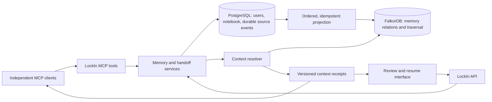

# LockIn Relay: research, competitive assessment, and hackathon build plan

Research date: **18 October 2026**. Planning checkpoint: approximately **13:26 IST**.

Repository: [Sky-walkerX/graph-hacks](https://github.com/Sky-walkerX/graph-hacks).

Status: sections 1–21 are the original research and design (about 13:26 IST). Sections 22–25, added at about 15:30 IST, refresh the competitor sweep, add past winners of similar tracks, and rank the features to build. The LockIn foundation is imported (commit `99e7e3a`) and FalkorDB runs in `docker-compose.yml`; no graph feature is implemented yet.

## 1. Recommendation

Build a narrowly focused extension called **LockIn Relay**:

> Switch coding agents without losing the decisions behind the work. See what changed, which unfinished work it affects, and the evidence the next agent used.

The most promising combination is:

1. **A change-aware handoff:** show the difference between the context an agent previously received and the accepted context available now.
2. **An impact map:** follow explicit relationships from a changed decision to dependent decisions, tasks, and open handoffs.
3. **A context receipt:** record the exact memory revisions delivered to the receiving agent, its acknowledgment, and the resulting task outcome.
4. **Human acceptance:** use LockIn's witness workflow to decide when a proposed replacement becomes authoritative.

These should form one continuous workflow. A longer feature list would spread implementation and demo time too thinly.

**Research changed the earlier recommendation:** persistent graph memory, human-reviewed contradictions, citations, MCP access, and even code-decision impact analysis already appear in public projects associated with this event. They are necessary foundations, but insufficient novelty claims. The opportunity is an unusually clear, useful, and demonstrably correct workflow for resuming real coding work across independent tools.

This is a differentiation hypothesis, not a claim of invention or a forecast of winning. No defensible win probability can be calculated from the available evidence.

## 2. Evidence quality and research limits

Sources were prioritized in this order:

1. Official event rules, FAQ, schedule, and organizer guidance.
2. First-party project repositories and authors' own project articles.
3. Official product documentation and original research papers.
4. Search results and aggregators only to discover leads, followed by primary sources where accessible.

Evidence labels used below:

- **Official:** published by the organizer or technology maintainer.
- **Observed in source:** read directly in the local LockIn implementation.
- **Author-reported:** a competitor's description or measurements; not independently reproduced.
- **Proposed:** our design, priorities, targets, and estimates.
- **Unverified:** registration, final submission, video playback, runtime behavior, or other facts not established by this research.

Competitor repositories were not executed and their benchmarks were not reproduced. Some deeper GitHub file requests failed. Linked videos were found, but attempts to open YouTube/Vimeo failed in the browsing tool and no controllable browser was available. The assessment therefore uses accessible repository READMEs and first-person articles, not claims of having watched those recordings.

Search visibility is incomplete: unlisted YouTube videos, private repositories, newly published pages, and account-only submissions may be absent. Public statements that a project is “built for” the event do not prove registration, acceptance, or final submission. Search-engine publication dates sometimes disagreed with page text; the official event schedule takes precedence.

## 3. Eligibility and the actual judging signals

### Published requirements

FalkorDB must be the primary graph database and central to the product. Decorative integration is excluded. Main coding/design must start during the event. Required materials include public source, setup, graph model, essential queries or algorithms, working video, and track selection. Local setup can substitute for deployment. Disclose AI assistance. Use permitted data; synthetic fixtures are the simplest choice here. These are requirements, not a numerical scoring rubric. [Official rules][S01]

The event closes **18 October 2026 at 23:59 IST**. At the planning checkpoint, approximately ten and a half hours remained; that is not a promise that all proposed work fits. [Official schedule][S03]

The FAQ allows reusable infrastructure but requires new submission work and a new main FalkorDB implementation during the event. Reusing a completed app remains an organizer-interpretation question. Record the existing foundation clearly and seek a ruling before relying on eligibility. Fresh commit timestamps do not resolve that question. [Official FAQ][S02]

### Track choice

**Primary: Agent Memory and Coordination.** The published emphasis includes persistent memory, cross-agent handoffs, concurrent access, and isolation. Track 01 is a secondary option only if the finished demo shows a graph-informed coding action. Company Brain would expand the scope substantially. The rules/FAQ allow multiple tracks; the organizer tutorial's single-track wording conflicts with that, so use the rules and submission form as authority. [Tracks and FAQ][S02] [Tutorial][S04]

### What we can infer, without inventing judging weights

The organizer's worked example uses bounded, typed tools with hand-written queries and visible traversal results. It distinguishes unknown data from an affirmative answer and shows the relationship path behind a result. This supports an implementation with explicit graph operations and inspectable outputs. It is guidance, not evidence that judges assign specific percentages to these qualities. [Organizer tutorial][S04]

Our proposed review questions are:

| Question | Concrete proof to prepare |
|---|---|
| Does FalkorDB do essential work? | Dependency traversal and context resolution stop when the graph is unavailable |
| Does memory change an agent's behavior? | A fresh coding session uses an accepted update and completes the relevant task |
| Is the workflow more useful than ordinary handoff notes? | Same task and evidence budget, evaluated against current LockIn |
| Can a reviewer inspect the explanation? | Exact revisions, source pages, graph paths, query IDs, and synchronization status |
| Does it survive realistic changes? | Replacements, missing evidence, late updates, restart, and concurrent pickup cases |
| Can another person reproduce it? | Seeded example, working setup, short walkthrough, recorded live run |

## 4. Public projects associated with this event

All capabilities in this section are **author-reported**, unless explicitly stated otherwise. Threat levels express similarity to our proposed positioning, not project quality rankings.

### Closest competitive references

| Project | What its public materials describe | Implication for LockIn |
|---|---|---|
| **AgentMesh** | Researcher/reviewer/planner workflow; persistent memories; contradiction cards; human choices; accepted replacements; provenance and graph UI. Its README distinguishes real providers from heuristic mock mode. [Repository][S06] | **Very close.** “Human-reviewed contradictions in graph memory” alone is already represented. Demonstrate independent coding clients completing work. |
| **Decision Brain** | Repository decisions connected to experiments, commits, files, and supersession; MCP tools; review of changes; graph-based work claims and handoffs. Reports a frozen 24-question comparison, with accuracy/latency tradeoffs and caveats. [Repository][S07] | **Very close and a high evidence bar.** Generic code-impact analysis and “remember failed attempts” also overlap. Context changes between real agent sessions must be especially clear. |
| **Recall Desk** | Three support agents sharing graph memory; persistent handoffs; dependency-based incident investigation; procedural outcomes; race/isolation checks. [Repository][S10] | **Strong Track 02 reference.** We need continuity across actual process/session boundaries and visible outcomes, not agents with different labels inside one prompt. |
| **Crew Memory Graph** | Planner/researcher/executor sharing episodic, semantic, and procedural memory. Its README reports a 14-question benchmark on a development backend and separately describes deployed FalkorDB; the later article makes additional live-system claims. [Repository][S08] [Author article][S09] | **Direct track overlap.** Separate our deterministic graph tests, real agent runs, and demo replays explicitly. |
| **Threadline** | Company knowledge over public GitHub data; streamed tool paths, 3D traversal replay, citation checks, and graph-versus-vector comparison. [Author article][S11] [Repository][S27] | **High presentation bar.** An animated graph by itself will not differentiate us. A small, readable before/after impact view can tell our story better. |
| **Cairn** | Decisions connected to their reasons and sources; later evidence challenging premises; change impact and handoff workflows. Its author discusses false-positive problems and source checking. [Author article][S12] | **Overlapping freshness story.** Distinguish explicit invalidation from uncertain semantic disagreement; demonstrate restraint on ambiguous changes. |
| **GraphDispatch** | Graph-based routing, constraints, remembered hazards, and decision explanations; author-reported comparative evaluation with limitations. Its README still contains video placeholders. [Repository][S13] | **Adjacent benchmark for execution quality.** A clear consequential action and reproducible evidence can be more persuasive than memory infrastructure alone. |

### Additional leads, not confirmed competitors

- **ZeroCapital Graph Memory:** repository describes bidirectional graph memory and a local recorded demo, but also dates work to September 9, before the published October event window. Treat it as related public work; do not assume eligibility or accuse the author of a rules violation. [Repository][S14]
- **howdycarter/graph-hacks-falkordb-2026:** accessible README is primarily an entry plan/checklist. It is evidence of intent, not of a finished competing implementation. [Repository][S15]
- Searches also surfaced **Universal Memory Mesh**, **Strata**, **Cortex**, and **Trace**. They are useful follow-up leads, but this report does not rely on unverified aggregator descriptions to rank them.

### Important comparative caveats

Decision Brain's README reports stronger answers than its keyword baseline at higher latency, but acknowledges a small dataset, one model, AI-authored evaluation material, and pending owner checks. Those are author claims, not a verified leaderboard. [Repository][S07]

Crew Memory Graph's blog and README describe different checkpoints. Its published 14/14 result should not be silently treated as an independently verified live-FalkorDB score. [Repository][S08] [Article][S09]

Do not compare counts of commits, tools, nodes, or agents as a proxy for quality. More hops do not automatically imply better reasoning. The relevant question is whether a relationship is necessary to answer the user correctly.

## 5. Video and demo links

**These links were discovered in first-party project materials. Playback was not verified.** They are a watchlist, not a watched-video review.

| Project | Recording | Link provenance and limitation |
|---|---|---|
| Decision Brain | [YouTube demo](https://www.youtube.com/watch?v=4OxUIsg-GYE) | Linked in its repository README. Direct playback fetch failed. [S07][S07] |
| Crew Memory Graph | [YouTube demo](https://www.youtube.com/watch?v=s3ceR7nJKyY) | Linked in the author's event article. Direct playback fetch failed. [S09][S09] |
| Threadline | [Vimeo demo](https://vimeo.com/1236637540) | Linked in both author article and repository. Direct fetch failed. [S11][S11] |
| Recall Desk | [Repository video](https://github.com/Pratheeksh-7S/Recall-Desk-/blob/main/docs/demo.mp4) | README describes a captioned two-minute recording. Not viewed. [S10][S10] |

For a later manual watch, record: seconds until the problem is clear; first live graph operation; whether context persists after restart; actual agent behavior; how sources are exposed; whether replay/mock mode is labeled; and whether the claimed result is visible. Do not score video quality before watching it.

Several entries link live apps, but this research did not validate their full runtime workflows. Treat live links as further inspection opportunities, not uptime guarantees.

## 6. Established products: what is already commonplace

These are market references, not identified hackathon entrants.

| Product | Supported by first-party documentation | Planning implication |
|---|---|---|
| **Graphiti** | Temporal facts, provenance, incremental updates, and hybrid retrieval; an MCP server supports FalkorDB. [Core][S16] [MCP][S17] | Temporal graph memory and cross-tool access are not novel claims. A complete Graphiti integration would also add another stack and extraction pipeline. |
| **Mem0 Platform** | Current documentation describes native entity-based graph connections influencing hybrid retrieval. The accessed page explicitly distinguishes this from its older external graph-store integration. [Docs][S18] | Avoid stale comparisons claiming Mem0 is merely a vector store. Compare a concrete workflow, not broad product slogans. |
| **Letta** | Current shared-memory guidance uses Git-backed repositories across cloud agents; older shared-block guidance is legacy. [Docs][S19] | Shared files and version history are real alternatives. Explain why an explicit impact traversal helps our chosen task. |
| **Hindsight** | Retain/recall/reflect, evidence-backed observations, and scoped memory practices. [Maintainer guide][S20] | “Memory with evidence” is not enough. Focus on changes to accepted context and downstream work. |

**Build-versus-adopt recommendation:** use the official FalkorDB TypeScript client directly for the first implementation. LockIn already has structured agent-written notes, identity, authentication, replacement metadata, and MCP. Reuse those strengths instead of introducing a second automatic extraction system. This is an engineering recommendation for this repository and deadline, not a claim that the frameworks above are inferior. [Client documentation][S22]

## 7. Where LockIn stands today

Local source inspected at commit `1a5924a5682cf415a22b00a2f5ae0376a144bd98`. The original working tree was clean at inspection.

| Observed existing capability | Relevant source | Consequence for the plan |
|---|---|---|
| MCP tools, per-agent identity, saving/searching notes | `app/api/mcp/route.ts` | Existing interface for real clients; extend rather than replace |
| Repo/file/commit anchors | `prisma/schema.prisma`, `lib/notes/anchor.ts` | Start from explicit metadata, not speculative entity extraction |
| Human witness and replacement status | `lib/notes/status.ts`, `app/api/milestones/[id]/route.ts` | Existing acceptance UX; graph must reflect accepted revisions correctly |
| Handoff text with pinned pages | `lib/handoff/store.ts`, `lib/handoff/card.ts` | Current lookup returns the pinned page contents; graph expansion can add new context |
| Session capture updates one note | `lib/notes/capture.ts` | Mutation means historical receipts need immutable snapshots or revision identities |
| Related-note retrieval via semantics or words | `lib/notes/related.ts` | Candidate discovery exists; relatedness is not a dependency or contradiction |
| Ask prompt assembly and source references | `lib/chat/retrieve.ts` | Reuse presentation conventions; full Ask integration is a later phase |
| Docker self-hosting | `docker-compose.yml` | Change copied image references so the new setup runs the new build |

Two specific correctness concerns surfaced through static reading, not runtime reproduction:

1. `pickUp` in the MCP route awaits `markPickedUp` but does not check its Boolean result before presenting the handoff as taken. The new workflow should test two callers racing to claim the same work.
2. `linkReplacement` rejects self-links and a direct reverse replacement. Longer cycles need explicit prevention before adding multi-hop traversal.

The existing app is a substantial foundation. However, maturity of the original notebook is not evidence of a working FalkorDB feature or of new event work. Our strongest proof must come from the new workflow.

## 8. Feature priority matrix

All ratings are proposed judgments: **H = high, M = medium, L = low**. They are not organizer scores or measured outcomes. Novelty means distinctiveness within the inspected sample, not the entire market.

| Feature | User value | Demo clarity | Graph necessity | Distinctiveness | Delivery risk | Priority |
|---|---|---|---|---|---|---|
| What changed since this handoff/context receipt | H | H | H when resolving chains | M–H | M | P0 |
| Impact on dependent tasks and open handoffs | H | H | H | M–H | M | P0, narrowly scoped |
| Current accepted memory resolution | H | H | H | L–M | M | P0 foundation |
| Real Claude/Codex cross-session continuation | H | H | M–H | M | M | P0 demonstration |
| Exact evidence paths and context receipts | H | H | H | M | M | P0 |
| Restart, update consistency, and isolation proof | H | M | H | M | M | P0 validation |
| Compact interactive impact view | M | H | M | M | L–M | P1 |
| Scoped failed-attempt recall | H | H | M–H | L–M | M | P1 |
| Changed-file context check | H | H | H | L–M | M–H | P1 |
| Historical replay of accepted state | M | H | H | L–M | H | P2 |
| Learned procedural playbooks | M–H | M | M | L–M | H | P2 |
| Branch-aware memory forks/merges | H for advanced use | H | H | Uncertain | Very high | Defer |
| Broad company-data ingestion | M | M | H | Low | Very high | Defer |
| Generic 3D graph exploration | L for core task | H initially | L | Low | M–H | Defer |

### The smallest competitive slice

One repository, one changed decision, two dependent tasks, one handoff, two independent agent sessions, and one independently checked coding outcome. Expand only after this works reliably.

## 9. Feature specifications and acceptance criteria

### F1. Current accepted context and change summary

**User question:** “What changed since the last agent worked on this?”

**Inputs:** authenticated user, handoff or previous context receipt, repository, target task, optional changed files.

**Behavior:** resolve each referenced revision through accepted replacements; compare with the earlier receipt; report added, replaced, withdrawn, and unresolved items. Explain which task makes an item relevant. A timestamp alone must not decide which assertion is authoritative.

**Visible result:** a concise list such as “Retry policy changed; one test task needs review; deployment notes are unchanged.” Counts must come from the query, not model-generated copy.

**Acceptance:** unaccepted proposals remain visibly provisional; an accepted chain reaches its terminal revision; incompatible accepted successors produce an unresolved conflict; stale or missing data is identified; empty results do not mean the repository has no relevant constraints.

### F2. Impact on unfinished work

**User question:** “If we accept this replacement, what needs another look?”

Use explicit `DEPENDS_ON` and `USES_MEMORY` relationships to identify affected tasks and handoffs. Display the reason path, such as:

`accepted replacement → old retry policy ← checkout task ← handoff`

**Before acceptance:** preview potential impact. **After acceptance:** affected work acquires a “context changed” indication until reviewed against a fresh receipt.

Do not automatically label the task wrong or reopen completed work. Shared file references yield “possibly relevant,” not “proven affected.” A graph path establishes recorded dependency, not semantic correctness.

**Acceptance:** transitive impact is found; unrelated work stays unaffected; duplicate paths do not double-count tasks; cycles terminate; uncertain links remain distinct from asserted dependencies.

### F3. Context receipts and acknowledgment

A receipt records the context actually delivered: stable revision IDs, source hashes, graph version/watermark, query identity, evidence paths, scope, timestamp, exclusions, and warnings. Use deterministic application logic to produce this manifest.

The receiving agent acknowledges that receipt when claiming the handoff. Before recording a successful outcome, the server can check whether the referenced accepted context has changed.

**Important limit:** this can enforce freshness for LockIn's own handoff/task operations. It cannot guarantee that an external coding assistant will obey advice or prevent arbitrary edits in its editor. Claims should describe observed behavior and the controlled protocol.

**Acceptance:** source edits do not silently rewrite old receipts; acknowledgments bind to one receipt; changed context is detected; one handoff has one successful claimant; a recorded outcome links to its receipt and test evidence.

### F4. Actual cross-agent continuation

Use two existing MCP clients with separate agent identities and fresh sessions. The second client receives the task prompt and retrieves context from the server. Do not paste the first agent's full transcript into its prompt.

Record the producer's write, the human acceptance, the consumer's retrieval, and the consumer's action. Persist enough state to repeat pickup after an application restart.

**Acceptance:** the graph supplies the changed decision; the receiver cites the correct source; a small independent test passes after its edit. If only one real client is available, demonstrate independent sessions honestly and describe cross-client support as tested only where verified.

### F5. “Why this context?” presentation

Three coordinated areas are sufficient:

- **Resume:** task, last handoff, changed context, unresolved questions, next step.
- **Impact:** a focused subgraph of the changed decision and affected work, usually fewer than twenty visible nodes.
- **Evidence:** exact source revision, acceptance status, query, path, and receipt.

Selecting an affected task highlights the actual returned path. Use labels and icons alongside colors. Keep the ordinary note pages accessible. Never use an animation to imply a traversal that did not execute.

**Acceptance:** a reviewer can identify what changed and why it matters without reading Cypher; technical details remain expandable.

### F6. Failed-attempt memory, only after the core

Turn the existing handoff's `tried` entries into scoped records: attempted approach, applicable conditions, observed failure, evidence, and when it was tested. Retrieve them when the current task depends on the same accepted constraints.

A past failure is not a permanent prohibition. If its assumptions have changed, show “previous failure may no longer apply.” An agent can propose a new experiment rather than inheriting a stale warning.

**Acceptance:** relevant failed attempts are recalled; unrelated ones are excluded; invalidated assumptions remove blanket “do not retry” wording.

### F7. Changed-file preflight, only after the core

Accept a caller-provided list of changed files and a verified repository/commit identity. Resolve file-linked memories and their downstream tasks. Return accepted constraints, uncertain context, and scoped failed attempts.

Do not promise automatic source-code understanding from file paths alone. Actual Git diff collection requires an explicit client-side integration and must be demonstrated. The core demo can use an openly available synthetic repository.

## 10. Proposed architecture and authority boundaries

**Authority must be explicit.** PostgreSQL owns existing notebook records and their durable mutation events. FalkorDB owns graph-only dependency links and serves the graph projection used for resolution. Accepted notebook replacements originate in the existing review workflow and are projected into the graph; do not maintain two independent acceptance decisions.

Receipts and graph-only links need durable storage and backup. Prefer storing graph-native links and receipt relationships in FalkorDB; a notebook projection rebuild must preserve them. Rebuilding notebook nodes is not the same operation as deleting the entire user graph.

A transactional outbox can record notebook mutations in the same PostgreSQL transaction. A small projector processes events in order per user/scope, with idempotency and version checks. Successful projection advances an applied watermark only after the relevant graph updates complete. Failed events remain pending and retryable.

Read operations should require the relevant applied watermark, then verify source revision hashes when assembling content. Until the graph catches up, return “synchronizing” or an explicit incomplete-context status. Do not serve a stale result as authoritative simply because the note write succeeded.

This architecture permits the old notebook to remain usable without FalkorDB, but the **submitted Relay workflow must depend on it** for resolution, impact, and receipt validation. This is our interpretation of a central feature, not an organizer ruling on the broader application's eligibility.

### Proposed graph entities

| Entity | Important properties |
|---|---|
| Repository | Stable repository identity; explicit normalization rules |
| File | Repository ID plus normalized path |
| Agent | Auth-derived identity; display name is not authorization |
| Session | Scoped external session ID; observed start/end |
| MemoryRevision | Note ID, revision ID, content hash, source time, recorded time, accepted state |
| Task | Stable task ID, status, owning scope |
| Handoff | Producer, goal, state, claim status, referenced context |
| Receipt | Revision manifest, graph version, warnings, consumer and acknowledgment |
| Attempt / Outcome | Optional scoped approach, observations, artifact/test reference |

### Relationship meanings

| Relationship | Meaning and origin |
|---|---|
| `RECORDED`, `PRODUCED` | Agent/session provenance from authenticated writes |
| `ABOUT_FILE`, `IN_REPOSITORY` | Explicit anchors; relevance rather than truth |
| `SUPERSEDES` | Proposed or accepted revision transition; acceptance tied to reviewed revision |
| `DEPENDS_ON` | Explicit decision/task dependency with a source and assertion status |
| `REFERENCES`, `USES_MEMORY` | Handoff/task context requirements |
| `DELIVERED`, `ACKNOWLEDGED` | Context supplied to and acknowledged by the consumer |
| `ATTEMPTED`, `RESULTED_IN` | Optional attempt/outcome provenance |

Use immutable revision identities for historical evidence. A mutable note and its current `witnessedAt` are insufficient to prove what an agent read earlier. Keep event occurrence, recording, and acceptance times separate. Commit timestamps do not establish branch ancestry; branch-aware validity is deferred.

## 11. Query and MCP plan

Prefer parameterized, named Cypher queries over agent-generated Cypher. FalkorDB implements OpenCypher with extensions and documented limitations; validate all planned patterns on a pinned version. Use the official TypeScript client. [Cypher reference][S23] [Clients][S22]

| Operation | Graph work | Output |
|---|---|---|
| `resolve_context` | Scope lookup, accepted replacement chains, typed dependency expansion | Current/provisional context, warnings, evidence paths |
| `preview_memory_change` | Reverse dependency walk from a proposed replacement | Affected decisions, tasks, and handoffs |
| `pickup_handoff` extension | Resolve current context and claim work | Handoff plus versioned receipt |
| `acknowledge_context` | Bind consumer to delivered revision manifest | Acknowledgment and freshness state |
| `explain_context` | Read receipt and evidence relationships | Human-readable explanation plus query details |
| `record_outcome` extension | Link task/attempt to receipt and evidence | Outcome provenance, with stale-context warning when applicable |

For the first slice, combine preview/explanation into the core tool responses rather than creating six separate public tools immediately. Preserve existing MCP authorization and bounded response sizes.

Guardrails for correctness:

- Derive graph names from authenticated account IDs; never accept a graph name supplied by the agent.
- Bound traversal depth, candidate count, result count, and response budget. Return truncation explicitly.
- Index stable identifiers and repository/file lookup keys.
- Test parallel-edge behavior. FalkorDB documents cases where an unused relationship alias yields existential rather than multiplicity-sensitive matching.
- A final `LIMIT` does not bound eager mutations; limit the matched work before writing. [Known limitations][S24]
- Use graph algorithms only for a justified operation. Bounded traversal solves this project's main problem; PageRank does not establish truth or acceptance. [Algorithm reference][S25]
- A reachable source is not proof of a claim. Validate cited revision identity and quoted content; retain uncertainty about semantic interpretation.

## 12. Implementation map against existing LockIn

| Existing area | Planned change |
|---|---|
| `lib/notes/write.ts` | Emit durable revision/relationship events for relevant mutations; detect replacement cycles |
| `lib/notes/capture.ts` | Preserve historical revisions when session captures append content |
| `app/api/milestones/[id]/route.ts` | Make witness acceptance revision-specific; publish the corresponding event atomically |
| `lib/notes/status.ts` | Keep UI status consistent with accepted successor semantics; expose unresolved cases |
| `lib/handoff/store.ts` | Retrieve/claim handoffs with context receipts; respect failed concurrent claims |
| `app/api/mcp/route.ts` | Add graph-aware resolution to pickup and typed dependencies to writes |
| `lib/notes/related.ts` | Use existing retrieval only for candidates; explicit validation creates dependency links |
| `app/components/home/contents.tsx` | Surface changed-context handoffs and focused review entry points |
| `docker-compose.yml` | New app build, isolated PostgreSQL/graph volumes, FalkorDB readiness |
| New `lib/graph/` | Client, query catalogue, projection, resolution, impact, receipt operations |
| New `eval/` and demo fixtures | Frozen cases, independent expected results, run logs, demo reset |

Before implementation, read the relevant installed Next.js guides in `node_modules/next/dist/docs/`, as required by this repository's AGENTS.md. This document does not assume framework APIs are unchanged.

Do not reuse the original deployment's database, uploads, credentials, OAuth configuration, or agent tokens. Use isolated synthetic data and a separately configured instance.

## 13. Evaluation that can distinguish this work

LongMemEval separates extraction, multi-session reasoning, temporal reasoning, knowledge updates, and abstention. Use those categories to design a small task-specific suite, without claiming to have run LongMemEval itself. [Original paper][S21]

### Freeze a compact fixture set before tuning

Start with 12 deterministic cases; expand to roughly 20 only if time permits:

1. Ordinary current note lookup, where both baseline and graph should succeed.
2. Direct accepted replacement.
3. Three-step replacement chain.
4. Replacement still awaiting witness.
5. Two incompatible successors without a resolved preference.
6. Task explicitly depending on a replaced decision.
7. Transitive dependency affecting an open handoff.
8. Same-file note with no asserted dependency: relevance only.
9. Missing source or withdrawn evidence.
10. Receipt becoming stale between pickup and acknowledgment/outcome.
11. Another user with overlapping IDs or identical titles.
12. Restart and repeated delivery of the same projection event.

Add negative controls for unaffected tasks, deletion/rebuild, concurrent pickup, a replacement cycle, stale failed attempts, and out-of-order events.

### Baselines

| Baseline | Purpose |
|---|---|
| Existing LockIn handoff + pinned pages | Measures the actual improvement over our foundation |
| Existing LockIn search, including current replacement filtering | Avoids deliberately disabling a feature the original already has |
| Same agent/model with the same available documents and comparable context budget | Measures the effect of retrieval, not a different model or withheld facts |
| Simple structured reference resolver over fixture data | Checks graph result correctness independently; not a claim about database speed |

Keep task prompts, fixture versions, model, generation settings, and context budgets fixed where possible. If model capacity or provider changes, report paired comparisons separately. Do not manufacture a failure by hiding essential evidence from only one baseline.

### Metrics and proof artifacts

- Correct current-revision selection.
- Precision/recall of affected tasks against manually specified dependency fixtures.
- Provisional or stale claims incorrectly presented as accepted.
- Correct abstention on missing or conflicting evidence.
- Source/revision/path validity.
- End-to-end task success against an independent test.
- Context tokens delivered, graph-query latency, complete pickup latency, and model latency separately.
- Successful unique claim count under a controlled race.
- No cross-user context leakage in the test fixtures.

Record sample size, hardware, network location, graph size, warm/cold state, model calls, and failures. A dozen fixtures prove specific behaviors; they are not broad statistical evidence. Publish all runs, including failures. A graph can make relationships easier to inspect without being inherently more accurate than a correctly implemented relational alternative.

### Proposed release gates

- Every deterministic correctness case passes against real FalkorDB, not only a mock.
- No cross-user result in the isolation fixtures.
- One claimant per contested handoff in the tested race.
- Restart preserves accepted context and receipts.
- A fresh-clone local setup completes the main scenario.
- At least one real agent continuation succeeds with independently checked output.

These are acceptance targets, not results achieved during this planning session.

## 14. Demo script: one problem, one visible consequence

Target approximately three minutes; this is a presentation recommendation, not a discovered video-length rule.

Use a synthetic checkout repository. The initial accepted decision allows retrying checkout requests. A later confirmed finding establishes that the current payment operation lacks an idempotency guarantee. The replacement decision limits retries until that condition is met. The unfinished retry task depends explicitly on the old decision.

| Time | What appears | What it proves |
|---|---|---|
| 0:00–0:20 | Existing handoff: retry task, old policy, next step | A familiar developer problem |
| 0:20–0:50 | New evidence, proposed replacement, impact preview | Graph connects a memory change to unfinished work |
| 0:50–1:10 | User accepts the revision; focused impact paths update | Human control has an observable consequence |
| 1:10–1:50 | Fresh independent agent picks up; sees what changed and acknowledges receipt | Cross-session continuity without pasted history |
| 1:50–2:20 | Agent adjusts the small task; independent fixture test passes | Context changes behavior, not just the answer text |
| 2:20–2:45 | Open receipt: exact revisions, paths, source, query and timestamp | Inspectable evidence |
| 2:45–3:00 | Show concise comparison results and setup link | Reproducibility and honest scope |

Do not narrate a baseline failure unless the baseline actually failed in the recorded run. A baseline may succeed by searching more; token use or time may still reveal a useful difference.

Keep a reproducible seeded run for review. If a saved trace is replayed, label it “recorded run”; it is not a live model response. The video should include real tool execution. Do not substitute the original LockIn launch film.

## 15. Build sequence and deadline management

The following estimates are rough engineering judgments for someone familiar with LockIn. They exclude unexpected deployment/account problems and are not a guaranteed same-day schedule.

| Phase | Deliverable | Rough effort | Stop condition |
|---|---|---|---|
| A | Copy foundation, provenance, isolated local services, first real graph query | 45–75 min | New environment runs independently |
| B | Minimal revision projection and accepted-chain resolver | 90–150 min | A real update changes the resolver result |
| C | One explicit task dependency, impact query, receipt-aware pickup | 90–150 min | Main scenario works through MCP |
| D | Focused change/impact/evidence interface | 45–90 min | Reviewer can understand the change visually |
| E | Deterministic tests, fresh-session agent run, setup verification | 60–120 min | Core release gates pass |
| F | Video, submission README, source links, deployment or local package | 60–120 min | Submission materials are usable |

Total range: approximately **6.5–12 hours**, with substantial uncertainty. The upper end exceeds the time remaining at the research checkpoint. Reserve submission/video time first and cut scope early.

### If only 4–6 implementation hours remain

Ship replacement resolution, one-level explicit task impact, receipt-aware pickup, a small evidence panel, one real agent demo, and local setup. Defer automatic impact propagation across large task graphs, hooks, generic extraction, procedural learning, and historical replay. A smaller completed entry is preferable to screenshots of planned behavior.

### Gates that prevent wasted effort

- If the real graph round trip and basic persistence are not reliable, stop UI work.
- If the accepted-update resolver cannot pass its fixtures, drop optional retrieval enhancements.
- If receipt synchronization cannot guarantee freshness, reduce supported mutation paths and expose the limitation; never mark stale data as current.
- If deployment consumes the remaining buffer, finish local setup and video.
- If the core behavior cannot be demonstrated by the deadline, do not claim it exists.

## 16. Repository, commits, and provenance

The new directory currently exists and was empty at inspection. For the later implementation step:

1. Copy source without `.git`, credentials, caches, dependencies, generated build outputs, uploads, or private data.
2. Preserve this research document and the existing project license/attribution.
3. Initialize a fresh repository and document the imported source commit.
4. Make an explicit baseline-import commit, followed by meaningful implementation commits at their actual times.
5. Keep new graph work and evaluation visible in the diff from that baseline.

Suggested milestones:

- `docs: record research and hackathon scope`
- `chore: import LockIn foundation with provenance`
- `feat: add isolated FalkorDB runtime and revision projection`
- `feat: resolve accepted memory and task impact`
- `feat: deliver graph-backed context receipts through MCP`
- `feat: show context changes and evidence in handoffs`
- `test: validate memory updates and cross-agent continuation`
- `docs: publish setup, evaluation, demo guide, and disclosures`

If work crosses midnight, preserve the actual date. The repository history should explain what happened, not imply that the original app was written during the event.

## 17. Submission package and positioning

Lead the project page with the new problem and demonstrated behavior. Keep the original notebook's broader feature catalogue secondary.

Proposed one-sentence description:

> LockIn Relay uses FalkorDB to update a coding handoff when decisions change, trace the unfinished work affected, and show exactly which context the next agent used.

Proposed README order:

1. Thirty-second explanation and new demo video.
2. Fastest runnable example.
3. What was reused and what was built during the event.
4. Graph model and essential query catalogue.
5. Walkthrough of the changed-decision scenario.
6. Evaluation method, results, failures, and limitations.
7. Architecture, synchronization, scope, and agent configuration.
8. AI-assistance disclosure and attribution.

The submission screenshot requires a public/unlisted YouTube demo. Use the new implementation's deployment URL, or the permitted local setup alternative. The original live site belongs in a clearly labeled foundation/reference link.

The official page advertises a blog side prize. A useful article would explain a real engineering lesson—such as why accepting a new memory must invalidate a stale handoff—and include measured examples. It should not divert time from the working entry. [Event page][S02]

## 18. Risks and decisions to settle during implementation

| Risk | Recommended response |
|---|---|
| Organizer does not allow this amount of prior application reuse | Obtain a precise ruling; show imported foundation and genuinely new contribution |
| Competitors already cover similar features | Avoid “first” claims; compete on coherent workflow and evidence |
| Synchronization causes false freshness | Durable events, ordered projection, watermark checks, explicit pending state |
| Mutable source destroys history | Versioned evidence snapshots and hashes; acceptance binds to revision |
| False semantic contradictions | Start with explicit replacements/dependencies; proposals remain provisional |
| Work changes during pickup | Receipt/version validation and a tested claim protocol |
| External agents ignore context | Record actual tool use and outcomes; avoid universal enforcement claims |
| Demo relies on an unavailable provider | Local seeded graph walkthrough plus labeled recorded run; real agent run separately |
| Too many graph algorithms or integrations | Keep only operations used by the main scenario |
| “Evidence verified” sounds stronger than it is | State exactly what passed: identity/hash/quote/path checks, not proof of truth |

## 19. Candid assessment

**Current state:** a mature notebook and MCP foundation, but no demonstrated FalkorDB workflow. It is behind the inspected projects on hackathon-specific graph evidence.

**After a superficial integration:** technically closer to the theme, but weak against entries already showing persistent graph workflows and evaluations.

**After the focused plan:** plausibly competitive if it delivers a clear real-world task, handles changing context correctly, and makes that behavior easy to verify. The differentiator is the integrated experience and its proof, not a broad claim that nobody else has agent memory or impact analysis.

The strongest next implementation objective is therefore: **a stale handoff becomes an accurate, acknowledged continuation, with the affected work and source revisions visible.**

## 22. Competitors update (about 15:10 IST)

All capabilities are **author-reported** from READMEs; live URLs were checked only for an HTTP 200, not for working demos.

**The field is large.** A GitHub search for repositories pushed since 14 October that mention `falkordb` returns about 329 results, 83 of them pushed after 13:26 IST today. At least six entries now overlap directly with change-aware handoffs, impact maps and context receipts. Three other entries are already named "Relay".

| Project | Track(s) | Pitch | Graph use | Polish | Overlap |
|---|---|---|---|---|---|
| [sahil1330/ripple][C01] | 01+02+03 | Company brain that remembers which fact version it told people and agents, and returns to correct it | `FactVersion` + `SUPERSEDES`, `WAS_TOLD`/`CACHED` edges, `IMPACTS`, atomic task claims, `check_fresh` MCP guard, graph per tenant | Live on Railway; video TODO | **H**: receipts + impact, for policy facts |
| [Lecrupus/hivemind][C02] | 02 | Time-aware shared memory for Claude Code, Cursor, Codex | Bi-temporal facts, `Handoff-[:CARRIES]->Fact`, atomic `CLAIM_TASK`, `why()` provenance, PageRank/WCC, graph per workspace | Live; 2-min video; ~1,300 ops/s at 100 agents; Track 02 bullet table | **H** |
| [Quantapixel/hivemind][C03] | 02 | Shared brain for several coding agents on one repo | Call graph, `shortestPath` conflict warnings, decisions with `SUPERSEDES` | Live; two videos; CLI | **H** |
| [blackstackdev/agent-office-relay][C04] | 02+03 | Source-linked handoffs with human approval | Policy amendment marks the old packet outdated; Cypher catalogue | Local only; pages demo | **H** concept, M polish |
| [Aryan7098/codemem][C05] | 02 | Evidence-backed memory for coding agents | `SUPPORTED_BY` evidence, git change → stale blast radius, `Handoff-[:REFERENCES_MEMORY]` | No video or live URL | **H** concept, low polish |
| [tharunkumardeveloper/The-Final-Boss][C06] ("Relay"/WiFight) | 02 | Agents that never message each other yet never contradict | Time-aware memory, graph per tenant, `algo.maxFlow`, 14 MCP tools | Very polished; live; blog; 99.4% vs 61.3% claim; 0 duplicates with 8 writers | **H** for the T02 prize |
| [PratikPawar1401/relay-agent-memory][C07] | 02 | Incident memory that survives a handoff | Fencing claims; stores selected IDs, context hash and source revision before the model call | Local only; created today | **M–H**: has receipts |
| [Vaibhaav-Tiwari/lineage][C08] | 02+03 | Company brain that un-learns | Reversed decision → walk to answers, beliefs, queued actions | Live | **M–H** |
| [lurui1997/rationale-guard][C09] | 01, 02, 03 | Shows which past decision a PR breaks | `File←TOUCHES←PR←DERIVED_FROM←Decision`, PageRank to choose who to ask, GitHub Action | Created today | **M** |
| Cascade cluster: [Quorum][C10], [Pedigree][C11], [Kintsugi][C12], [RETCON][C13] | 02 | "Git revert" for agent beliefs | Provenance DAG walks; `GRAPH.COPY` preview | Kintsugi live + video; RETCON blog | **M**: they own "cascade invalidation" |
| Collision prevention: [Switchboard][C14], [Airspace][C15], [Pheromone][C16] | 02 | Stop parallel coding agents colliding | Import/code graph claims | Two live | **M/L**: crowded |
| [zeyusuntt/inherit-brain][C17] | 03 | Ask the product you inherited | 9 read-only Cypher tools; evaluated on 1,203 held-out questions | Video + blog | **L** overlap, strong T03 rival |

Others: [Vaibhav91one/ripple][C18], [undograph][C19], [relayops][C20], [recallbrake][C21], [relay-graph][C22], [ResultRipple][C23], [what-leaves-with-them][C24], plus many Track 03 "keep knowledge current" entries (Strata, Gary, Tombstone, Staleproof, Chronos, Workweave). Of the projects in section 4, none showed a push after 13:26 IST; Crew Memory Graph's live site returned 502 at 15:05 IST and GraphDispatch's video is still a placeholder.

**Gaps nobody fills well (proposed reading of the sample):**

1. **Receipts that act, for coding-agent handoffs.** Ripple tracks what people were told; PratikPawar/Relay hashes context for incidents; Hivemind records which handoffs carried a fact. None shows: handoff receipt → decision superseded → "agent B is on revision 2, current is 3" → diff → re-brief → acknowledgement.
2. **Human witness as graph state.** Others script approval or use a queue. LockIn's witness workflow can decide what is delivered as accepted and answer "who witnessed what".
3. **Point-in-time replay:** "what did the agent know when it did X". Receipts and revision history make this cheap.
4. **Published concurrency numbers.** Only Hivemind and WiFight give figures, and Track 02 asks for them.
5. **Real dogfood data.** Nearly every rival uses a synthetic company. A graph of our own build's notes and handoffs would stand out.
6. **Naming.** Avoid "Relay": three entries already use it.

## 23. What won similar tracks

| Event | Winner | Magic moment | Why it won |
|---|---|---|---|
| WeMakeDevs × Cognee (graph memory, Jun–Jul 2026), Track 1 | [Lethe][W01] | Forget a component → receipt of nodes/edges/vectors removed → re-ask gives the right answer | Organizer: "makes forgetting a product feature… re-queries to prove the removal" [W02]. Blind-judge benchmark vs RAG that reports ties and losses, honest limits, AI disclosure |
| Same, Track 2 | [Classroom Memory][W03] | "Class is failing recursion → teach functions first" from the prerequisite graph | Per-student private memory plus a shared graph; 12-check live verification script [W02] |
| FalkorDB "Memory Meets Motion" (Aug 2026), 1st | [Atrium][W04] | Same score, different misconceptions → grouped by a two-hop traversal | "A flat table or a vector search simply cannot express" it [W05] |
| Same, standouts | [Hopper][W06], [Drift][W07], [Oto.ai][W08] | "No path found = proof of safety"; meeting contradicts an earlier decision → issue updated behind approval; agent resumes a developer's session from a task graph and opens a PR saying what it inherited | FalkorDB's own write-up [W05]. Oto.ai is the closest analogue to LockIn |
| Neo4j Aura Agent Hackathon 2026, 1st–3rd | ConspiracyGraph, RegulatoryRisk, Korca Triage | Claim related to fact-checks and frames; who-knows-what routing | "originality of the use case, the quality of the graph model… practical business value" [W09] |
| WeMakeDevs × Coral (May 2026) | [Manthan][W10] | One click resolves an $8,400 dispute to a cited $560 credit after approval | Inferred: real business case, one-click demo, polish [W11] |
| MCP 1st Birthday (Nov 2025), Best Overall | [Cite-Before-Act][W12] | Human approval before any state-changing MCP call | Published criteria: completeness, UX, functionality, creativity, docs, impact [W13] |

**WeMakeDevs' published rubric for a graph-memory event** (Cognee): potential impact, creativity, technical excellence, best use of the sponsor (depth of its APIs), UX, presentation (demo, README, submission). [W14] Their 2026 write-ups keep praising provable claims (receipts, re-queries, verification scripts), refusing to guess, human approval gates and structural guards, and honest limits. [W02] [W15] (Inferred as a consistent taste.)

**Patterns that win:** one graph-only magic moment shown before/after; the graph model shown and justified with named Cypher queries; provenance on every answer; memory lifecycle rather than storage; a small honest evaluation; human gates; a one-click seeded demo with a live URL and a ~2–3 minute video; the README as the pitch.

**Anti-patterns:** graph as decoration, or a product that still works without FalkorDB (rule 3); chat-over-docs a vector store could do; feature sprawl without one story; claims without proof; localhost-only demo; a README without the graph model; one giant final commit.

## 24. Ranked feature shortlist for Tracks 02 + 03

Scores are proposed judgments (5 = best; for risk, 5 = safest within about 8 hours). Judge appeal follows sections 22–23.

| # | Feature | Track bullets | Judge appeal | Graph necessity | Distinct | Demo clarity | Build risk | Extends |
|---|---|---|---|---|---|---|---|---|
| 1 | **Context receipts + stale-handoff re-brief.** `pickup_handoff` resolves context through the graph and writes a `Receipt` (`DELIVERED` revision IDs + hashes). When an accepted replacement lands later, `check_receipt` returns "you're on rev 2, current is rev 3", the diff, and the impact path; the agent acknowledges a fresh receipt | 02 shared state & handoffs; 03 keeping knowledge current, tracing to source | 5 | 5 | 5 | 5 | 3 | `app/api/mcp/route.ts`, `lib/handoff/store.ts`, new `lib/graph/` |
| 2 | **Witness-gated memory as graph state.** Witnessing a replacement (existing UI) projects `SUPERSEDES {accepted:true}`; unwitnessed proposals are delivered as provisional, never as accepted; "who witnessed what" query | 02 memory updates over time; 03 who knows what, sources | 4 | 4 | 5 | 5 | 4 | `lib/notes/status.ts`, `lib/notes/write.ts`, `app/api/milestones/[id]/route.ts` |
| 3 | **Impact map.** Bounded reverse walk `Decision ←DEPENDS_ON* Task ←FOR Handoff` from a changed decision; preview before acceptance, "context changed" badge after; small panel shows the actual returned path | 03 tracing decisions; 02 shared state | 5 | 5 | 3 | 5 | 3 | `lib/notes/related.ts` (candidates only), new MCP `link_dependency`, `app/components/home/contents.tsx` |
| 4 | **Atomic claims + concurrency proof.** Fix the unchecked `markPickedUp` result; N-agent claim race and receipt-write benchmark against FalkorDB, published with numbers | 02 high-concurrency reads/writes | 4 | 3 | 3 | 4 | 5 | `app/api/mcp/route.ts`, new `eval/` |
| 5 | **Graph per user/tenant.** Graph name derived from the authenticated user; isolation test with overlapping IDs/titles | 02 separate memory per user/tenant | 3 | 4 | 2 | 3 | 5 | new `lib/graph/client.ts` |
| 6 | **Episodic / semantic / procedural mapping.** Sessions + handoffs (episodic), witnessed notes/decisions (semantic), `tried` entries as scoped `Attempt` nodes recalled when their assumptions still hold (procedural) | 02 episodic, semantic, procedural; persistent history | 4 | 4 | 3 | 3 | 3 | `lib/notes/capture.ts`, `lib/handoff/card.ts` |
| 7 | **Company Brain layer: who owns / knows what, cited Ask.** Traversals over Agent/User/File/Decision/Handoff ("who last decided anything about `lib/payments`", "which agents were told the old policy"); Ask answers cite graph paths | 03 who owns/knows, answers with sources, docs/tickets/chats in one graph | 4 | 5 | 3 | 4 | 3 | `lib/chat/retrieve.ts`, new MCP `who_knows` |
| 8 | **Point-in-time replay.** "What did agent B know when it closed task X": render the receipt as of then vs now | 02 persistent history; 03 tracing | 4 | 4 | 4 | 4 | 3 | receipts from #1 |
| 9 | **Honest evaluation + verification script.** 12 frozen fixtures (section 13) against real FalkorDB; one real Claude Code continuation; report ties and failures | All (presentation) | 5 | — | 3 | 3 | 4 | new `eval/` |
| 10 | **Dogfood graph.** Seed the demo from LockIn's own hackathon-build notes and handoffs, labelled as such | Presentation, 03 | 3 | — | 4 | 3 | 4 | seed script |
| 11 | **Submission package + blog.** README with graph model, Cypher catalogue, track-bullet table, reuse disclosure; 2–3 min video; live GCP URL; dev.to post for the blog prize | Required | 5 | — | — | 5 | 4 | `README.md`, `deploy/gcp/` |

**Deferred:** cascade invalidation as the headline (Quorum, Pedigree, Kintsugi and RETCON own it), edit-collision prevention (crowded), 3D/generic graph views, broad document ingestion, learned playbooks, branch-aware memory.

**Positioning:** lead with *a handoff that knows when it went stale, and a receipt that proves what the next agent was told*. Brand it as LockIn (for example "LockIn Baton"), not "Relay".

## 25. Recommended build cut for about 8 hours

| Order | Scope | Rough time |
|---|---|---|
| 1 | `lib/graph/` client, per-user graph (#5), projection of notes, witnessed `SUPERSEDES`, handoffs (#2) | 1.5 h |
| 2 | Receipts on pickup, `check_receipt` diff and re-brief (#1), atomic claim fix (#4 part) | 1.5 h |
| 3 | `link_dependency` + impact query and panel (#3) | 1.5 h |
| 4 | Fixtures, claim race numbers, one real agent continuation (#9, #4) | 1 h |
| 5 | Deploy to GCP, README, video (#11) | 1.5–2 h |
| Stretch | #7 who-knows-what + cited Ask, #8 replay, #6 attempts, blog | if time remains |

Representative queries used on 18 October 2026:

- `"FalkorDB" "hackathon" "2026" submission demo`
- `site:youtube.com/watch "FalkorDB" "hackathon"`
- `site:youtube.com/watch "Graph Hacks"`
- `"Graph Hacks" "submission"`
- `site:github.com "wemakedevs" "falkordb"`
- `"Graph Hacks" "judging" FalkorDB`
- `"Graph Hacks" "youtu.be"`
- `"Decision Brain" "FalkorDB" github`
- `"FalkorDB" "agent memory" "hackathon" demo October 2026`
- `site:github.com/getzep/graphiti temporal knowledge graph FalkorDB MCP`
- `site:docs.mem0.ai "Graph Memory"`
- `site:docs.letta.com "shared memory" agents`
- `site:arxiv.org/abs "LongMemEval"`
- `site:github.com/vectorize-io/hindsight memory retain recall reflect`

No complete public entrant roster, numeric judging weights, verified acceptance status, or independently audited leaderboard was established. This report is a sample of discoverable work, not a census of submissions.

## 21. Source register

All sources below were accessed or inspected on 18 October 2026. Repository and product pages can change. Primary-source authors' performance statements remain their claims.

| ID | Source | Used for |
|---|---|---|
| S01 | [Event rules][S01] | Eligibility and submission requirements |
| S02 | [Event overview and FAQ][S02] | Track fit, reuse wording, blog opportunity |
| S03 | [Event schedule][S03] | Deadline |
| S04 | [Organizer's graph-agent tutorial][S04] | Design guidance; not a scoring rubric |
| S05 | [Official resources][S05] | First-party documentation discovery |
| S06 | [AgentMesh repository][S06] | Close feature overlap |
| S07 | [Decision Brain repository][S07] | Close workflow overlap, video, reported evaluation |
| S08 | [Crew Memory Graph repository][S08] | Track competitor and benchmark limitations |
| S09 | [Crew Memory Graph author article][S09] | Later description and YouTube link |
| S10 | [Recall Desk repository][S10] | Shared-memory workflow and local recording |
| S11 | [Threadline author article][S11] | Demo link and presentation approach |
| S12 | [Cairn author article][S12] | Premise freshness and false-positive lessons |
| S13 | [GraphDispatch repository][S13] | Adjacent action/evaluation reference |
| S14 | [ZeroCapital Graph Memory repository][S14] | Related lead with date ambiguity |
| S15 | [Graph Hacks planning repository][S15] | Intent only, not confirmed finished entry |
| S16 | [Graphiti core repository][S16] | Temporal graph-memory market reference |
| S17 | [Graphiti MCP documentation][S17] | Existing MCP/FalkorDB integration |
| S18 | [Mem0 Platform graph-memory documentation][S18] | Current platform behavior; avoid outdated comparison |
| S19 | [Letta shared-memory documentation][S19] | Current Git-backed alternative |
| S20 | [Hindsight maintainer best-practices guide][S20] | Evidence-backed memory reference |
| S21 | [LongMemEval paper][S21] | Evaluation categories |
| S22 | [FalkorDB client documentation][S22] | TypeScript integration choice |
| S23 | [FalkorDB Cypher reference][S23] | Query design |
| S24 | [FalkorDB known limitations][S24] | Query correctness risks |
| S25 | [FalkorDB algorithms][S25] | Available tools; use only when justified |
| S26 | [Original LockIn repository][S26] | Foundation identity; local source was inspected |
| S27 | [Threadline repository][S27] | First-party corroboration of project and demo link |
| S28 | [Cairn repository][S28] | First-party corroboration of event project |

[C01]: https://github.com/sahil1330/ripple
[C02]: https://github.com/Lecrupus/hivemind
[C03]: https://github.com/Quantapixel/hivemind
[C04]: https://github.com/blackstackdev/agent-office-relay
[C05]: https://github.com/Aryan7098/codemem
[C06]: https://github.com/tharunkumardeveloper/The-Final-Boss
[C07]: https://github.com/PratikPawar1401/relay-agent-memory
[C08]: https://github.com/Vaibhaav-Tiwari/lineage
[C09]: https://github.com/lurui1997/rationale-guard
[C10]: https://github.com/HamzaShaikh-source/Quorum-falkordb
[C11]: https://github.com/Vedant817/pedigree
[C12]: https://github.com/Itz-Agasta/kintsugi
[C13]: https://github.com/mtrx28/retcon
[C14]: https://github.com/bhargava-gumpula/graph-hacks
[C15]: https://github.com/sushanshetty1/airspace
[C16]: https://github.com/karankartikeya/pheromone
[C17]: https://github.com/zeyusuntt/inherit-brain
[C18]: https://github.com/Vaibhav91one/ripple
[C19]: https://github.com/Tejas-Sands/undograph
[C20]: https://github.com/dan-el-7/relayops
[C21]: https://github.com/avinashnegi1999/recallbrake
[C22]: https://github.com/ahirmaan/relay-graph
[C23]: https://github.com/Asembris/ResultRipple
[C24]: https://github.com/retailbox-automation/what-leaves-with-them
[W01]: https://github.com/vinayaksonthalia/lethe
[W02]: https://archive.wemakedevs.org/hackathons/cognee/projects
[W03]: https://github.com/RajdeepKushwaha5/ClassroomMemory
[W04]: https://github.com/nathansso/Atrium
[W05]: https://www.falkordb.com/blog/memory-meets-motion-the-falkordb-standouts/
[W06]: https://github.com/vraj00222/hopper
[W07]: https://github.com/sharique2004/mmm-demo
[W08]: https://github.com/KrishnaJ-bit/Memory_Meets_Motion
[W09]: https://community.neo4j.com/t/aura-agent-hackathon-winners-announced/79568
[W10]: https://github.com/akash-mondal/manthan
[W11]: https://archive.wemakedevs.org/hackathons/coral/projects
[W12]: https://huggingface.co/spaces/MCP-1st-Birthday/cite-before-act-mcp
[W13]: https://huggingface.co/MCP-1st-Birthday
[W14]: https://archive.wemakedevs.org/hackathons/cognee
[W15]: https://www.wemakedevs.org/hackathons/trueforge/projects
[S01]: https://www.wemakedevs.org/hackathons/falkordb/rules
[S02]: https://www.wemakedevs.org/hackathons/falkordb
[S03]: https://www.wemakedevs.org/hackathons/falkordb/schedule
[S04]: https://www.wemakedevs.org/blogs/how-to-build-an-agent-that-reasons-over-a-graph
[S05]: https://www.wemakedevs.org/hackathons/falkordb/resources
[S06]: https://github.com/MOHITPRADHAN35/agentmesh
[S07]: https://github.com/PeterGreenAppliedAI/decision-brain
[S08]: https://github.com/AI-conn/crew-memory-graph
[S09]: https://dev.to/aiconn/we-stopped-passing-context-through-prompts-we-gave-the-crew-a-graph-instead-5h6j
[S10]: https://github.com/Pratheeksh-7S/Recall-Desk-
[S11]: https://dev.to/starknight/a-company-brain-that-shows-its-work-multi-hop-graphrag-on-falkordb-with-every-hop-replayed-in-3d-141f
[S12]: https://dev.to/bikash_kh_/i-built-a-company-brain-that-remembers-why-decisions-were-made-on-falkordb-c7
[S13]: https://github.com/aggarmoksh/GraphDispatch
[S14]: https://github.com/renigat7-cpu/graph-hacks-2026
[S15]: https://github.com/howdycarter/graph-hacks-falkordb-2026
[S16]: https://github.com/getzep/graphiti
[S17]: https://github.com/getzep/graphiti/blob/main/mcp_server/README.md
[S18]: https://docs.mem0.ai/platform/features/graph-memory
[S19]: https://docs.letta.com/concepts/shared-memory
[S20]: https://github.com/vectorize-io/hindsight/blob/main/hindsight-docs/src/pages/best-practices.mdx
[S21]: https://arxiv.org/abs/2410.10813
[S22]: https://docs.falkordb.com/getting-started/clients
[S23]: https://docs.falkordb.com/cypher/
[S24]: https://docs.falkordb.com/cypher/known-limitations
[S25]: https://docs.falkordb.com/algorithms/
[S26]: https://github.com/Sky-walkerX/LockIn
[S27]: https://github.com/StarKnightt/threadline
[S28]: https://github.com/kh-bikash/cairn
