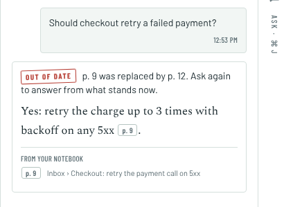

<div align="center">


<p>
  <a href="https://github.com/Sky-walkerX/graph-hacks/stargazers"></a>
  <a href="https://github.com/Sky-walkerX/graph-hacks/actions/workflows/ci.yml"></a>
  <a href="https://github.com/Sky-walkerX/graph-hacks/commits"></a>
  <a href="LICENSE"></a>
</p>
<p>
  
  
  
  
  
  
</p>

**[Watch the demo](https://youtu.be/3gQTzyWkOSE)** · [Try LockIn](https://35-244-57-220.sslip.io) · [Features](#keeping-agent-context-current) · [Set it up](#set-it-up) · [How it works](docs/how-it-works.md) · [Build story](docs/blog.md)

</div>

[LockIn](https://github.com/Sky-walkerX/graph-hacks) is an open-source notebook your AI tools write to. Claude Code, Codex and Cursor can save and find notes over MCP. You review what they record, and a handoff lets another agent continue unfinished work with the decisions and next steps it needs.

Notes can include the repository, commit and files they describe, so an agent can check whether they still apply. Ask answers questions over your notes, saved links and PDFs with page citations, using an in-browser model, a local server such as Ollama or LM Studio, or a supported provider connected with your own API key. When embeddings are available, larger notebooks use passage retrieval by meaning instead of relying only on the notebook digest.

Connect different tools and machines to the same reachable LockIn instance to carry project context between them. The [Claude Code plugin](integrations/claude-code) also captures summaries when sessions compact or end. Self-hosting lets you choose where the notebook lives; Ask sends the prepared question and context directly to your chosen model, so choosing a cloud model sends that material to its provider.

Decisions keep changing after a handoff. LockIn uses [FalkorDB](https://www.falkordb.com) to connect work to the decisions it depends on, record the pages and revisions delivered to each agent, and identify when that context changes. Agent notes can be searchable before you witness them; a proposed replacement retires the older note only after you witness it.

## How it fits together

[**Watch the complete 5:26 video on YouTube →**](https://youtu.be/3gQTzyWkOSE)

The video explains the problem, notebook workflow, architecture and FalkorDB integration, then follows **Claude Code → Codex** in a 50.5-second animated product walkthrough. The interface is recreated with illustrative payment data; it is not a live screen recording.

The shorter animation below gives a quick overview:


<p align="center"><sub>Claude Code decides and hands off. Codex picks up through the graph and gets a receipt. The decision changes, and the receipt knows. <a href="docs/media/manifest-film.mp4">MP4</a></sub></p>

## Keeping agent context current

1. **Graph-backed pickups come with a receipt.** FalkorDB works out what the next agent should read, including the decisions its task depends on, and records which page revisions it was handed, with the paths explaining why.
2. **Witnessed changes are followed.** If a page was replaced and you witnessed the new one, the agent gets the new page. Proposals you haven't witnessed come with a warning, never as the truth.
3. **Agents can check what changed.** `check_context` compares a receipt with the current notebook and can return the changed pages and a new receipt. The Claude Code plugin checks before every prompt; other MCP clients can call the same tool.
4. **Refresh before recording completion.** When a connected task has an outdated receipt, `update_plan_item` refuses to tick it done and names the change. The agent refreshes and checks its work before trying again.
5. **Impact before you approve.** Before you witness a replacement, preview the linked tasks, handoffs and agents that lean on the old decision.
6. **Finished work stays traceable.** A finished task remembers the receipt it was done against, and is flagged if a decision behind it changes later.
7. **Who knows what.** Search a topic or a file to see the decision that stands, who wrote it, and which agents hold an older version. Keystone decisions are ranked with FalkorDB's PageRank.
8. **Only one agent gets a handoff.** When several agents request the same open handoff, an atomic claim lets exactly one take it.
9. **Dead ends are remembered, and reopened.** What a handoff says was tried and ruled out is kept in the graph, tied to the decisions it assumed. The next agent on the task is told, and when one of those decisions is replaced, it hears the idea may be worth retrying.
10. **Ask answers know when they're out of date.** Each answer is linked to the pages it cites. When a cited note is replaced or a cited source is deleted, the answer is stamped *Out of date* in the chat and listed under *Answers to ask again*. Saved documents turn up in *Who knows what* too.
11. **Measured with concurrent agents.** A recorded load test on a 5,000-note graph reached 450 graph operations a second with 100 simulated agents; single-agent p50 was 6 ms. The test and FalkorDB shared 4 cores ([method and results](eval/LOAD.md)). These are graph-operation timings, not complete agent or model response times.

Dependencies are explicit links, and receipts record page IDs, revision hashes and explanation paths rather than full historical text. The completion check governs updates through LockIn; it cannot prevent arbitrary code edits or prove that an agent implemented a decision correctly. When FalkorDB is unavailable, pickup falls back to pinned pages without graph resolution or a new context receipt. See the [technical limits](docs/how-it-works.md#limits).

These features appear alongside your notebook in the app:

<picture>
  <source media="(prefers-color-scheme: dark)" srcset="docs/media/manifest-panel-dark.png">
  
</picture>

<table><tr>
<td width="50%"></td>
<td width="50%"></td>
</tr><tr>
<td width="50%"></td>
<td width="50%">Ask's answers live in the graph beside the decisions they cite. When a cited page is replaced, the answer says so.</td>
</tr></table>

## The graph


One graph per account. **Postgres** keeps notes, tasks, handoffs, chats, documents and retrieval passages with their embeddings. **FalkorDB** stores the relationships used to follow dependencies, accepted replacements, receipts, outcomes and the assumptions behind earlier attempts. Ask answers (`CITES`), saved documents and attempts (`TRIED`, `ASSUMED`) sit in the same graph. Semantic passage retrieval and graph traversal have different jobs; LockIn uses both. The queries, track mapping and limits are in **[How it works](docs/how-it-works.md)**.

## Verification

Recorded checks for the current Graph Hacks implementation:

| Check | Recorded result |
|---|---:|
| Frozen context and coordination cases ([`eval/baseline.mjs`](eval/baseline.mjs)) | **12 / 12** |
| Rounds with one winner, 8 agents racing ([`eval/race.mjs`](eval/race.mjs)) | **10 / 10** |
| End-to-end story ([`eval/scenario.mjs`](eval/scenario.mjs)) | **21 / 21** |
| Graph operations a second, 100 simulated agents ([`eval/LOAD.md`](eval/LOAD.md)) | **450** |

Details, ties and timings: [`eval/RESULTS.md`](eval/RESULTS.md).

## Set it up


You need Docker with Compose.

```sh
git clone https://github.com/Sky-walkerX/graph-hacks && cd graph-hacks
cp .env.example .env            # then set AUTH_SECRET:  openssl rand -base64 32
docker compose up -d --build    # Postgres, FalkorDB and LockIn on http://localhost:3000
```

Open **http://localhost:3000** and create an account. To enable PDF/link extraction and server-side embeddings, set `INGEST_URL=http://ingest:8080` and a long random `INGEST_SECRET` in `.env`, then run `docker compose --profile ingest up -d --build`. See the [self-hosting reference](docs/lockin.md#self-hosting) for HTTPS, email and other options.

Then play the story against it. It makes a demo account and prints the login:

```sh
node eval/scenario.mjs                 # the whole story, 21 checks
STOP_AFTER=7 node eval/scenario.mjs    # stop while Codex is out of date, then open the app
node eval/dogfood.mjs                  # a notebook of the decisions we made building this
```

To connect a real agent, create a token in **Settings → Connect your agents** and copy the setup for Claude Code, Codex or Cursor. The Streamable HTTP MCP endpoint is **`/api/mcp`** on your instance. The optional [Claude Code plugin](integrations/claude-code) adds session capture, handoff commands and automatic context checks. To put LockIn on a server, see [`deploy/gcp`](deploy/gcp/README.md).

## What's next

Team organisations with shared context for selected projects are future work. Today's notebooks and graphs are scoped to individual accounts.

## Built for Graph Hacks

Entered in **Track 02, Agent Memory and Coordination**, and **Track 03, Company Brain**, of [Graph Hacks](https://www.wemakedevs.org/hackathons/falkordb) (WeMakeDevs × FalkorDB). LockIn existed before the event and is imported as its own commit (`78a20d7`); everything since, including all of the FalkorDB work, was built during it. See [what was reused and what is new](docs/how-it-works.md#what-was-reused-and-what-is-new).

Built with Claude Code and OpenAI Codex as coding assistants for implementation, review, tests and production material. The films use Remotion and Google Gemini TTS with the Umbriel voice; see [`video/`](video). The original notebook's setup and development reference is in [`docs/lockin.md`](docs/lockin.md).

## License

AGPL-3.0-or-later, like LockIn. See [LICENSE](LICENSE).
