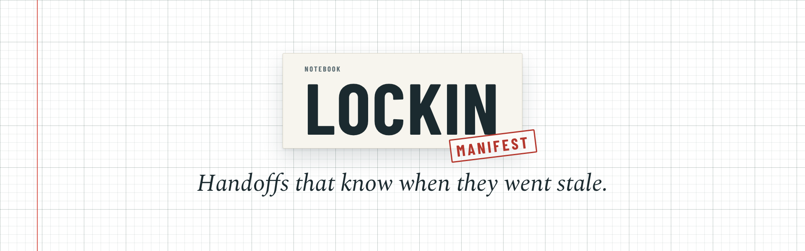
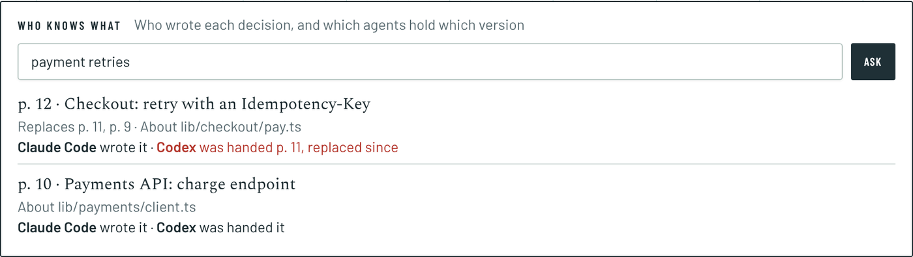
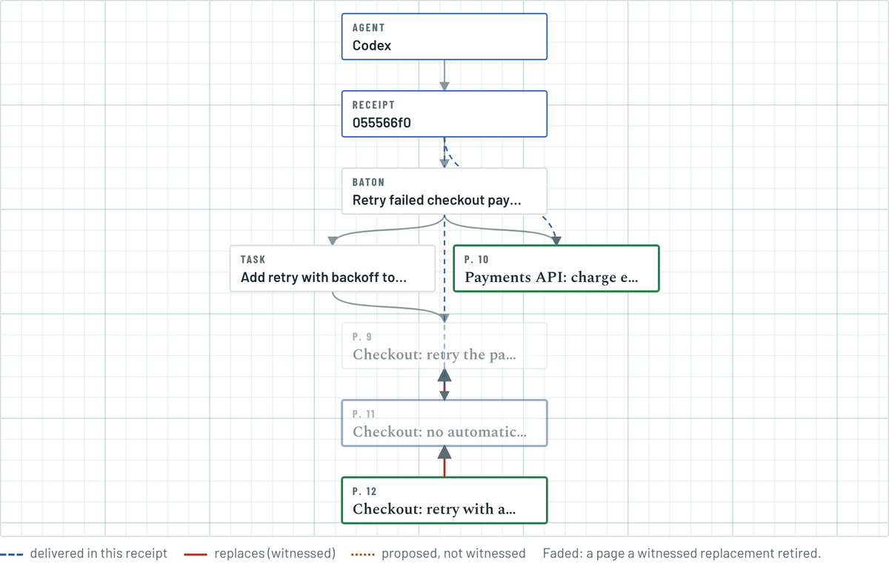
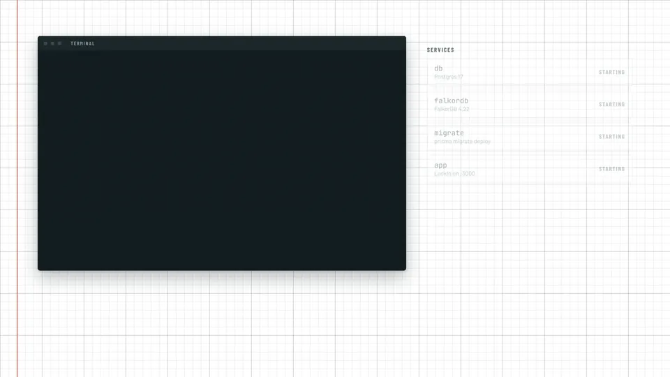

<div align="center">



<p>
  <a href="https://github.com/Sky-walkerX/graph-hacks/stargazers"></a>
  <a href="https://github.com/Sky-walkerX/graph-hacks/actions/workflows/ci.yml"></a>
  <a href="https://github.com/Sky-walkerX/graph-hacks/commits"></a>
  <a href="LICENSE"></a>
</p>
<p>
  
  
  
  
  
  
</p>

**[Watch it](#how-it-fits-together)** · [What's new](#whats-new-over-lockin) · [Set it up](#set-it-up) · [How it works](docs/how-it-works.md) · [Results](eval/RESULTS.md)

</div>

[LockIn](https://github.com/Sky-walkerX/LockIn) is the notebook your AI tools write to: Claude Code, Codex and Cursor save what they learn over MCP, you witness it, and one agent can hand its work to the next with a baton.

A baton is a snapshot, though, and decisions keep moving. **LockIn Manifest** puts the notebook in a [FalkorDB](https://www.falkordb.com) graph, so every handoff knows what it rests on, keeps a receipt of what the next agent was told, and catches it when that goes stale.

## How it fits together


<p align="center"><sub>Claude Code decides and hands off. Codex picks up through the graph and gets a receipt. The decision changes, and the receipt knows. <a href="docs/media/manifest-film.mp4">MP4</a></sub></p>

## What's new over LockIn

1. **Every handoff comes with a receipt.** FalkorDB works out what the next agent should read, including the decisions its task depends on, and records exactly which version of each page it was handed.
2. **Witnessed changes are followed.** If a page was replaced and you witnessed the new one, the agent gets the new page. Proposals you haven't witnessed come with a warning, never as the truth.
3. **Agents are told when the ground moves.** `check_context` says what changed since pickup and hands over the new pages. The Claude Code plugin checks before every prompt.
4. **Stale work can't be called done.** An agent can't tick a task done while its context has changed; LockIn names the change instead.
5. **Impact before you approve.** Before you witness a replacement, you see every task, baton and agent that leans on the old decision.
6. **Finished work stays traceable.** A finished task remembers the receipt it was done against, and is flagged if a decision behind it changes later.
7. **Who knows what.** Search a topic or a file to see the decision that stands, who wrote it, and which agents hold an older version. Keystone decisions are ranked with FalkorDB's PageRank.
8. **Only one agent gets a handoff.** The original told up to eight racing agents they had all taken the same baton. Now exactly one does.

All of it shows up in the app, beside LockIn's own panels:

<picture>
  <source media="(prefers-color-scheme: dark)" srcset="docs/media/manifest-panel-dark.png">
  
</picture>

<table><tr>
<td width="50%"></td>
<td width="50%"></td>
</tr></table>

## The graph


One graph per account. Postgres keeps notes, tasks and batons; FalkorDB walks them, and alone holds dependencies, receipts and outcomes. The queries, the track mapping and the limits are in **[How it works](docs/how-it-works.md)**.

## Tested against the original

The same twelve frozen cases, through the same MCP calls, against the original LockIn and against LockIn Manifest:

| | LockIn | LockIn Manifest |
|---|:---:|:---:|
| Frozen cases ([`eval/baseline.mjs`](eval/baseline.mjs)) | 5 / 12 | **12 / 12** |
| Rounds with one winner, 8 agents racing ([`eval/race.mjs`](eval/race.mjs)) | 0 / 10 | **10 / 10** |
| End-to-end story ([`eval/scenario.mjs`](eval/scenario.mjs)) | | **16 / 16** |

Details, ties and timings: [`eval/RESULTS.md`](eval/RESULTS.md).

## Set it up



You need Docker with Compose.

```sh
git clone https://github.com/Sky-walkerX/graph-hacks && cd graph-hacks
cp .env.example .env            # then set AUTH_SECRET:  openssl rand -base64 32
docker compose up -d --build    # Postgres, FalkorDB and LockIn on http://localhost:3000
```

Then play the story against it. It makes a demo account and prints the login:

```sh
node eval/scenario.mjs                 # the whole story, 16 checks
STOP_AFTER=7 node eval/scenario.mjs    # stop while Codex is out of date, then open the app
node eval/dogfood.mjs                  # a notebook of the decisions we made building this
```

To connect a real agent, create a token in **Settings → Connect your agents** and add the MCP server; the Claude Code plugin is in [`integrations/claude-code`](integrations/claude-code). To put it on a server, see [`deploy/gcp`](deploy/gcp/README.md).

## Built for Graph Hacks

Entered in **Track 02, Agent Memory and Coordination**, and **Track 03, Company Brain**, of [Graph Hacks](https://www.wemakedevs.org/hackathons/falkordb) (WeMakeDevs × FalkorDB). LockIn existed before the event and is imported as its own commit (`99e7e3a`); everything since, including all of the FalkorDB work, was built during it. See [what was reused and what is new](docs/how-it-works.md#what-was-reused-and-what-is-new).

Built with Claude Code as a pair programmer. The original LockIn README is in [`docs/lockin.md`](docs/lockin.md). The films are made with Remotion, in [`video/`](video).

## License

AGPL-3.0-or-later, like LockIn. See [LICENSE](LICENSE).
