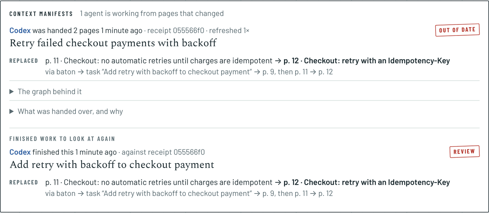
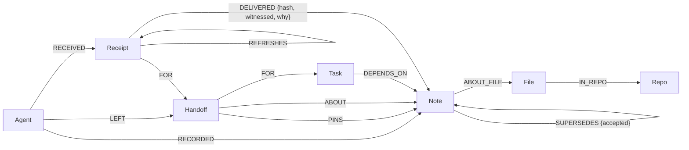

# LockIn Manifest

**When an agent picks up another agent's work, FalkorDB works out what it should read and keeps a receipt of what it was given. If a decision in that receipt is replaced and you witness the replacement, the agent is told before it calls the work done.**

Built for [Graph Hacks](https://www.wemakedevs.org/hackathons/falkordb) (WeMakeDevs × FalkorDB), on top of [LockIn](https://github.com/Sky-walkerX/LockIn), an open-source notebook that coding agents write to over MCP.

**Tracks:** 02 Agent Memory and Coordination (primary) · 03 Company Brain

**Demo video:** _added at submission_ · **Live:** _added at submission_ · **Setup:** [run it yourself](#run-it)



## The problem

Coding agents hand work to each other all the time: a usage cap, a `/clear`, or switching from Claude Code to Codex mid-feature. LockIn already let an agent leave a **baton** (goal, state, next step, pages to read) and another agent pick it up.

A baton is a snapshot, though, and decisions keep moving. Say Claude Code decides "retry the payment call on 5xx", plans a task on it, and hands off. Codex picks it up. Meanwhile Claude Code finds the payments API isn't idempotent, so a retry can charge a customer twice, and proposes replacing the decision. You witness the replacement. Codex is still implementing retries.

Notes and search don't catch this, because nothing connects *the page Codex was given* to *the decision that just changed* through *the task it's working on*. That connection is a graph walk.

## What it does

1. **Pickup through the graph.** `pickup_handoff` claims the baton atomically, then walks FalkorDB from it: pinned pages, the note it's about, and the notes its task **depends on**, up to 4 hops. Each note is followed through **witnessed** replacements to the page that stands now. Replacements still waiting for you to witness them come back as warnings, never as the current page. Two witnessed replacements of one page are reported as a conflict.
2. **A receipt.** Every page handed over is recorded on a `Receipt` node: its revision (a hash of its text), whether it was witnessed, and the path that made it relevant.
3. **A change check before "done".** `check_context` compares the receipt with the context now: replaced, edited, newly witnessed, withdrawn, or added since. `update_plan_item` **refuses to tick the task done** while the receipt is out of date, and names the change. With the new context taken (a fresh receipt that `REFRESHES` the old one), it goes through.
4. **Impact before you accept.** `supersede_note` and `impact_of_change` list everything that leans on a decision: tasks, batons and notes, each with its path, and which agents are working from it and whether their context is out of date.
5. **You can see it.** The home page's **Context manifests** panel shows each agent's current receipt, a Current / Out of date stamp, what changed with the path the graph walked, and the receipt itself.

The whole story runs as a script against a live instance (`eval/scenario.mjs`). Every check passes (the first 10 shown):

```
PASS link_dependency records task → decision
PASS pickup returns a context manifest with a receipt
PASS manifest delivers the decision the task depends on, with the path
PASS only one agent takes the baton
PASS the proposal previews what it affects, including the agent that was told
PASS an unwitnessed proposal doesn't change the context
PASS ticking done against a changed context is refused with the change
PASS check_context hands over the replacement
PASS ticking done after refreshing works
PASS impact_of_change finds the task through the replaced page, and codex now current
```

What Codex sees when it tries to finish the old plan:

```
Not ticked: the context you picked this task up with has changed.
- REPLACED: p. 9 "Checkout: retry the payment call on 5xx" was replaced by p. 11 "Checkout: no automatic
  retries until charges are idempotent" (note ce4f…), now witnessed. Reached via this baton → task
  "Add retry with backoff to checkout payment" → p. 9.
Call check_context to take the new context, check your work against it, then tick the task again.
```

## How the tracks map

| Track bullet | Where it is |
|---|---|
| **02** Shared state and handoffs between agents | Batons, graph-resolved context, receipts, `check_context` |
| **02** Memory should persist, update over time | Notes, plus witnessed `SUPERSEDES` chains, followed at every pickup |
| **02** High-concurrency reads and writes | Atomic claims; `eval/race.mjs`: 8 agents × 10 rounds, exactly one winner every round |
| **02** Separate memory per user or tenant | One FalkorDB graph per account, named from the signed-in user, never from agent input; tested |
| **02** Episodic, semantic, procedural memory | Sessions and batons (episodic), witnessed notes and decisions (semantic), batons' "tried and ruled out" (procedural, in the card) |
| **03** Tracing decisions back to their source | Every delivered page carries the path that made it relevant; receipts keep the exact revision |
| **03** Keeping knowledge current as things change | Witnessed replacements change what's delivered; out-of-date receipts are flagged and refused at "done" |
| **03** Who owns what, and who knows what | `RECORDED` (which agent wrote a decision), `RECEIVED`/`DELIVERED` (which agent was told what, and whether it's still true) |
| **03** Answers with clear sources | Manifest lines and the receipt table cite page, path and revision |

## Graph model

One graph per account (`lockin_<userId>`). Postgres stays the authority on notes, tasks and batons. They are projected into FalkorDB before every graph operation (`lib/graph/project.ts`), from a watermark on `updatedAt`. **Dependencies and receipts live only in the graph.**



| Node | Key properties |
|---|---|
| `Note` | `id`, `page`, `title`, `hash` (revision), `witnessed`, `source`, `deleted` (kept so old receipts still resolve) |
| `Handoff` | `id`, `goal`, `status` (OPEN, PICKED_UP, SUPERSEDED), `source`, `pickedUpBy` |
| `Task` | `id`, `title`, `done` |
| `Receipt` | `id`, `at`, `agent`, `handoff`, `warnings` |
| `Agent`, `File`, `Repo`, `Meta` | name / key; `Meta {key: 'sync'}` holds the projection watermark |

`SUPERSEDES.accepted` is true only once the replacing note is witnessed. An agent can propose retiring a page, but only you retire it.

## The queries the product depends on

All parameterized, all in `lib/graph/context.ts`. Traversals are bounded: 4 hops for context, 8 for a replacement chain, 12 pages per manifest.

**What a baton reaches, and why**: the start of every pickup:

```cypher
MATCH p = (h:Handoff {id: $h})-[:PINS|ABOUT|FOR|DEPENDS_ON*1..4]->(n:Note)
WHERE n.deleted = false
RETURN n.id AS id, [x IN nodes(p) | {kind: labels(x)[0], id: x.id, label: coalesce(x.title, x.goal, x.id), page: x.page}] AS via,
       length(p) AS hops
```

**The page that stands now**: follows only witnessed replacements. More than one head is a conflict:

```cypher
UNWIND $ids AS id
MATCH (n:Note {id: id})
OPTIONAL MATCH p = (n)<-[:SUPERSEDES*1..8 {accepted: true}]-(cur:Note)
WHERE NOT (cur)<-[:SUPERSEDES {accepted: true}]-(:Note)
RETURN id, collect(DISTINCT {id: cur.id, page: cur.page, title: cur.title, hash: cur.hash, witnessed: cur.witnessed,
                             chain: [x IN nodes(p) | x.page]}) AS heads
```

**Proposals waiting for a witness** (delivered as warnings):

```cypher
UNWIND $ids AS id
MATCH (n:Note {id: id})<-[:SUPERSEDES {accepted: false}]-(p:Note)
WHERE p.deleted = false
RETURN id, collect({id: p.id, page: p.page, title: p.title, source: p.source}) AS proposals
```

**The receipt**:

```cypher
MATCH (h:Handoff {id: $h})
MERGE (a:Agent {name: $agent})
CREATE (a)-[:RECEIVED]->(r:Receipt {id: $id, at: $at, agent: $agent, handoff: $h, warnings: $warnings})-[:FOR]->(h)
// then, per page:
MATCH (r:Receipt {id: $id}) UNWIND $items AS it MATCH (n:Note {id: it.id})
CREATE (r)-[:DELIVERED {hash: it.hash, witnessed: it.witnessed, page: it.page, title: it.title, why: it.why}]->(n)
```

`check_context` re-runs the first two queries for the receipt's baton and diffs them against `DELIVERED` (`diff()` in the same file).

**What leans on a decision**: through every page it replaced:

```cypher
MATCH (d:Note {id: $id})-[:SUPERSEDES*0..8]->(base:Note)
WITH DISTINCT base
MATCH p = (x)-[:DEPENDS_ON|FOR|PINS|ABOUT*1..4]->(base)
WHERE (x:Task OR x:Handoff OR x:Note) AND x.id <> $id
RETURN labels(x)[0] AS kind, x.id AS id, coalesce(x.title, x.goal) AS label, length(p) AS hops, ...
```

**Who is working from it, and whether that's still true**:

```cypher
MATCH (d:Note {id: $id})-[:SUPERSEDES*0..8]->(base:Note)
WITH DISTINCT base
MATCH (a:Agent)-[:RECEIVED]->(r:Receipt)-[dl:DELIVERED]->(n:Note)-[:DEPENDS_ON*0..4]->(base)
WHERE NOT ()-[:REFRESHES]->(r)
RETURN DISTINCT a.name AS agent, r.id AS receipt, r.at AS at, dl.page AS page,
       size([(n)<-[:SUPERSEDES {accepted: true}]-(:Note) | 1]) > 0 AS stale
```

**No dependency loops**:

```cypher
OPTIONAL MATCH (f) WHERE (f:Task OR f:Note) AND f.id = $from
OPTIONAL MATCH (t:Note {id: $to})
RETURN ..., id(f) = id(t) OR size([(t)-[:DEPENDS_ON*1..8]->(f) | 1]) > 0 AS loop
```

## Why a graph

The question at the heart of this, "has anything this agent was handed been replaced since, through the task it's working on?", is a variable-length walk across four kinds of thing: baton → task → decision → replacement chain. The answer has to come with the path, because the path is the explanation the agent and you act on. In tables it's a recursive join per question, and the path has to be rebuilt by hand. Here it's one pattern, and `nodes(p)` *is* the explanation.

Without FalkorDB there's no manifest: pickup still hands over the baton's pinned pages as they were left, and says plainly that replacements and dependencies aren't followed.

## Run it

```sh
git clone https://github.com/Sky-walkerX/graph-hacks && cd graph-hacks
cp .env.example .env
sed -i.bak "s|^AUTH_SECRET=.*|AUTH_SECRET=$(openssl rand -base64 32)|" .env
docker compose up -d --build          # Postgres + FalkorDB + LockIn on http://localhost:3000
```

Then play the story against it. This creates a demo account and two agent tokens, and prints the login:

```sh
BASE=http://localhost:3000 node eval/scenario.mjs
BASE=http://localhost:3000 STOP_AFTER=7 node eval/scenario.mjs   # stop while Codex is out of date, then open the app
BASE=http://localhost:3000 node eval/race.mjs                    # 8 agents racing for each baton
```

Sign-up is rate-limited. For repeated runs, set `RATE_LIMITS=off` in `.env`.

FalkorDB Browser is at http://localhost:3001 (connect to `localhost:6379`) if you want to look at the graph itself.

**Connect a real agent.** In LockIn, open **Settings → Connect your agents** and create a token. Then add the MCP server (`/api/mcp`) to Claude Code, Codex or Cursor. The Claude Code plugin is in [`integrations/claude-code`](integrations/claude-code). New tools: `check_context`, `link_dependency`, `impact_of_change`. Changed tools: `pickup_handoff`, `update_plan_item`, `supersede_note`.

**Deploy on GCP**: one VM running the same compose file behind Caddy, served at `https://<ip>.sslip.io`. See [`deploy/gcp`](deploy/gcp/README.md).

**Tests**: `FALKORDB_URL=redis://localhost:6379 pnpm test lib/graph` runs the graph walks against a real FalkorDB. That covers chains, conflicts, loops, receipts, diffs, impact, and isolation between accounts.

## Results

**Against the original LockIn.** We ran the same 12 frozen fixtures through the same MCP calls against the original LockIn (the imported commit) and against LockIn Manifest. The expectations were fixed before either ran. Full table: [`eval/RESULTS.md`](eval/RESULTS.md).

| | LockIn (original) | LockIn Manifest |
|---|---|---|
| Fixtures passed (`eval/baseline.mjs`) | **5/12** | **12/12** |
| Both pass | F1 unchanged page, F8 same-file note left out, F9 deleted page, F11 other account, F12 two-agent race | |
| Only Manifest passes | | F2 replaced page, F3 three-step chain, F4 pending proposal warned, F5 conflict flagged, F6 task dependency, F7 transitive dependency, F10 "done" refused after a change |
| 8 agents racing for one baton, 10 rounds (`eval/race.mjs`) | **0/10** rounds with one winner: 5–8 agents per round were each told they had it | **10/10** |

The original's pickup is a snapshot of the pinned pages, by design. These fixtures are the cases where the notebook moved on after the baton was left, which is when a snapshot goes wrong.

**The rest**, on one machine. The numbers include HTTP, auth, Postgres and FalkorDB together, so they are not a FalkorDB benchmark:

| Check | Result |
|---|---|
| Scenario (`eval/scenario.mjs`) | 13/13 checks pass |
| Graph tests (`lib/graph/context.test.ts`, real FalkorDB) | 10/10 pass |
| Race, production Docker stack, 8 agents × 10 rounds | one winner every round; pickup p50 89 ms, p95 123 ms |
| Race, production Docker stack, 16 agents × 10 rounds | one winner every round; pickup p50 144 ms, p95 197 ms; 16 concurrent `check_context` in 133 ms |

## What was reused and what is new

LockIn existed before the event. The import is its own commit (`99e7e3a`, from `Sky-walkerX/LockIn@1a5924a`), so `git diff 99e7e3a` shows everything built during Graph Hacks.

| Before the event (LockIn) | Built during Graph Hacks |
|---|---|
| Notebook, MCP server, agent tokens, batons (`save_handoff` / `pickup_handoff`), witness workflow, `supersede_note`, Docker Compose | All of `lib/graph/` (FalkorDB client, per-account graphs, projection, context walks, receipts, diff, impact); `check_context`, `link_dependency`, `impact_of_change`; graph-backed `pickup_handoff`; the "done" guard in `update_plan_item`; impact preview in `supersede_note`; the fix for an unchecked claim in pickup; the Context manifests panel and `/api/manifest`; FalkorDB in Compose; GCP deploy; `eval/` |

The original LockIn README is at [`docs/lockin.md`](docs/lockin.md). The research and plan behind this entry are in [`LOCKIN_FALKORDB_RESEARCH_AND_PLAN.md`](LOCKIN_FALKORDB_RESEARCH_AND_PLAN.md).

## Limits

- **The guard covers LockIn's own operations.** Ticking a task done through LockIn is refused while the receipt is out of date. Nothing stops an agent from editing code it was told is out of date; the manifest tells it, it doesn't enforce it.
- **Dependencies are explicit.** A task depends on a decision because an agent or you said so (`link_dependency`), not because anything was inferred from text. Notes about the same file are not treated as dependent.
- **Revisions are hashes of the current text,** not a version history. A receipt can tell you a page changed since, but not show the old text.
- **The projection syncs before every graph operation.** It costs a Postgres query or two per call, and is built for one person's notebook, not a large organization.
- The numbers above come from a dev server on one machine.

## AI assistance

Built with Claude Code (Anthropic) as a pair programmer: research, code, tests and docs, directed and reviewed by the author. The commit history shows the work as it happened.

## License

AGPL-3.0-or-later, like LockIn. See [LICENSE](LICENSE).
